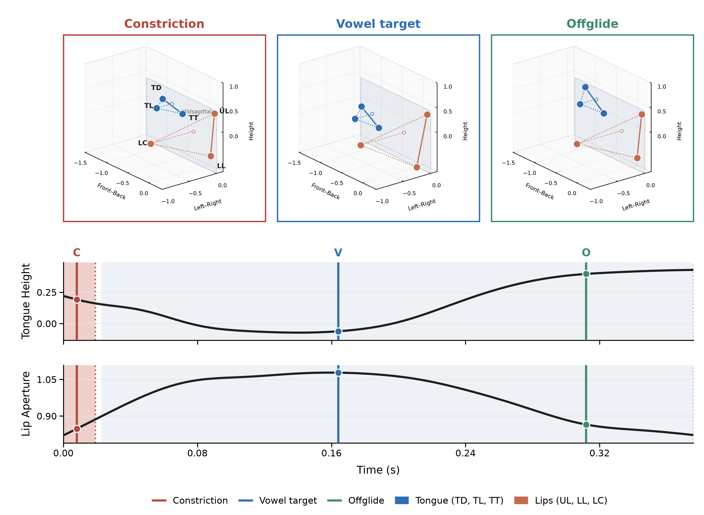
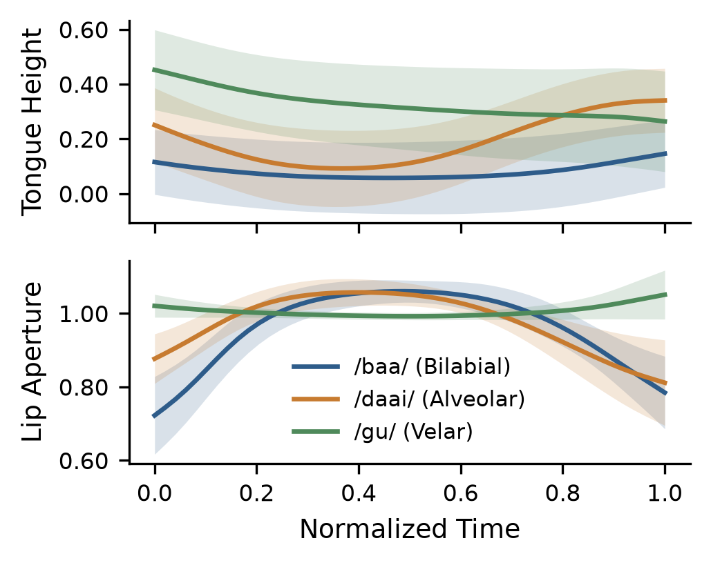
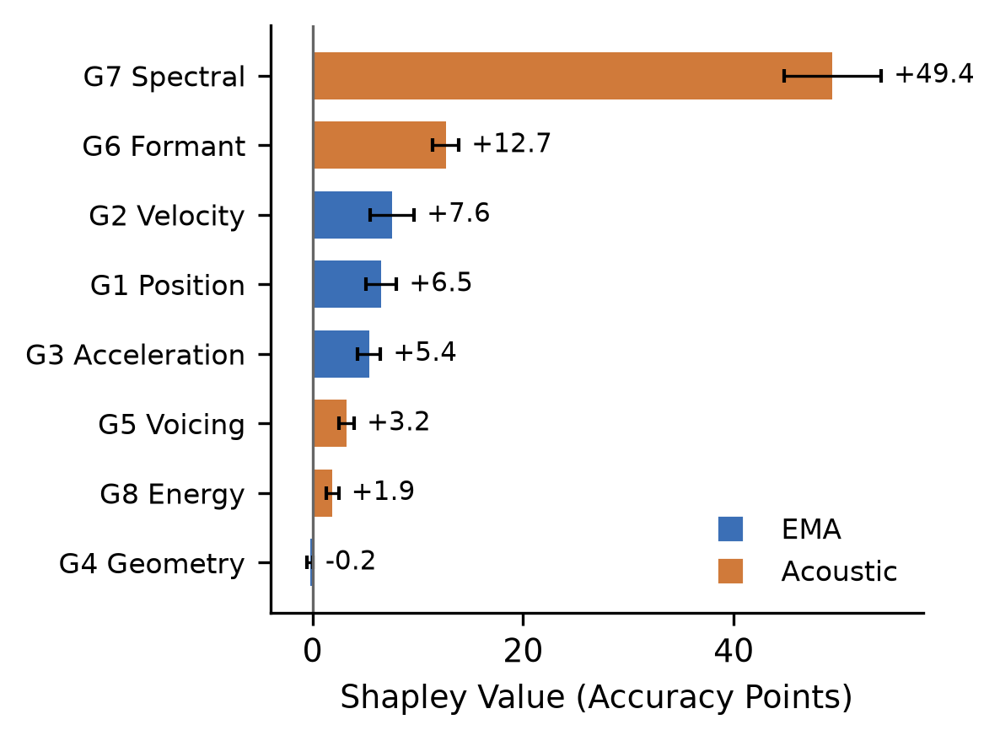
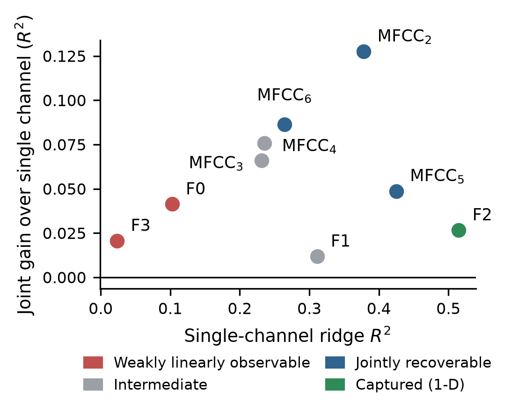
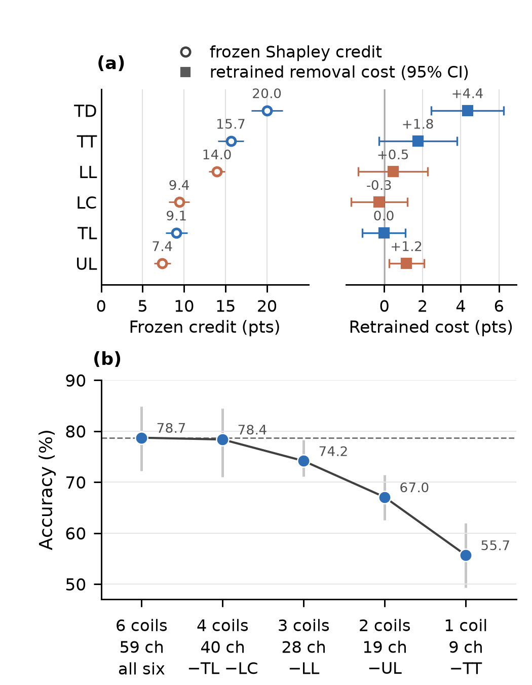
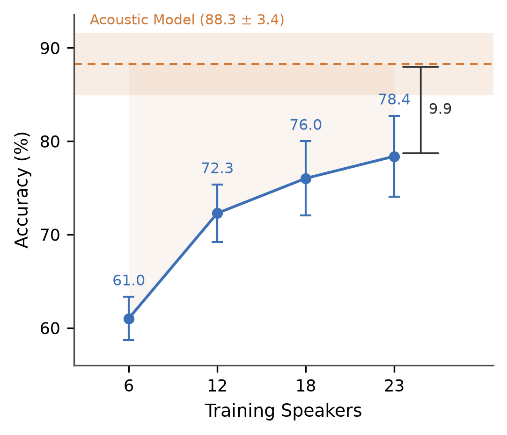
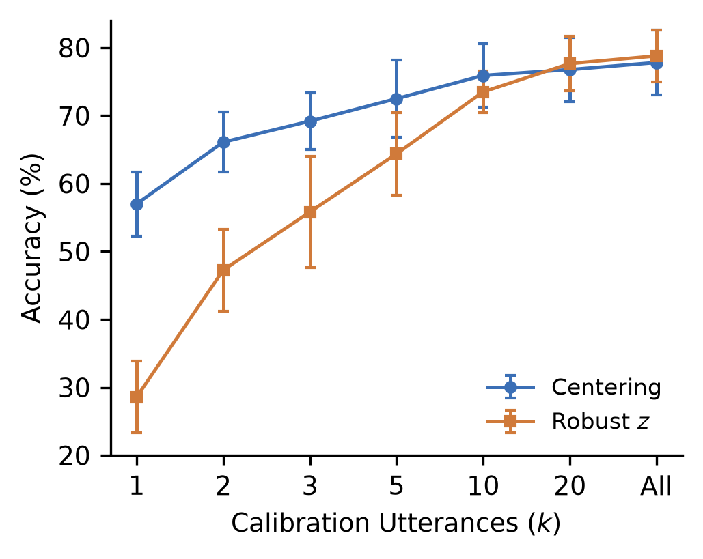

# CIS-EMA — observability analysis of an EMA silent speech interface

Code and reference results for *"What Does an EMA-Based Silent Speech Interface Capture? A
Feature-Attribution and Observability Analysis of Cantonese Syllable Recognition."*

An EMA-only BiLSTM reaches **78.71 %** on 43-way Cantonese syllable recognition, **88.28 %**
with hand-crafted acoustics and **94.13 %** for fine-tuned HuBERT. The paper asks where the
remaining gap comes from — a better decoder, or sensors that never observed the information —
and separates the two with exact Shapley attribution, linear probes, ridge/gradient-boosted
recoverability, knowledge distillation and retrained sensor removal.

```
┌──────────────────────────────────────────────────────────────────────────────────┐
│  78.71 %   EMA-only BiLSTM, 59 channels, 6-fold subject-disjoint CV, 2 seeds      │
│  88.28 %   same backbone + 47 hand-crafted acoustic channels                      │
│  94.13 %   HuBERT-large on raw audio (the acoustic ceiling)                       │
│   9.57 %   the gap this repository is about                                       │
└──────────────────────────────────────────────────────────────────────────────────┘
```



<div align="center"><sub>
One /daai/ utterance at three landmarks — constriction, vowel target and offglide — with the
six-coil montage above and tongue-height and lip-aperture trajectories below.
</sub></div>

**Every number in the paper is machine-checked.** `verify_results.py` recomputes all
**63 claims** from the reference artifacts shipped in `expected/` and compares them with the
value printed in the manuscript. It currently reports `63/63 checks passed`.

What was verified when this repository was assembled:

| check | result |
|---|---|
| claims ledger against shipped artifacts | **63/63** pass, no corpus needed |
| frozen folds vs the subject lists recorded in the original run artifacts | identical, all 6 folds |
| Table I re-run, 12 fold-seeds, both models | EMA-only **78.22** (published 78.71), full **88.16** (88.28) |
| SAIT-EMA 405-way re-run from public data | **39.45 ± 7.92** (published 39.31 ± 8.17) |
| ten figure builders on the shipped artifacts | reproduce the manuscript figures |
| paired tests re-derived from artifacts | reproduce the paper's values exactly |
| tone / F0 ceiling probes re-run | 73.07 EMA vs 73.03, 73.77 full vs 73.93 (probe-level sklearn drift) |

---

## What is and is not reproducible from this repository

The **CIS-EMA corpus is not publicly released**: the recordings were made under an ethics
approval whose consent did not cover public disclosure. Every line of code that consumes it is
here, and the *identical* pipeline runs end-to-end on a **public** corpus, so the method itself
is fully checkable. Please read this table before filing an issue about missing data.

| | Result | Public data enough? | Needs CIS-EMA? |
|---|---|---|---|
| **Method** — folds, BiLSTM, exact Shapley, probing, calibration, leave-one-coil-out | all of it | ✅ on SAIT-EMA (section IV-G) | — |
| Table I | ceilings: 78.71 / 88.28 / 94.13 | — | ✅ |
| Table II | normalization ablation | ✅ SAIT equivalents (IV-G) | ✅ for the CIS column |
| Table III | mechanistic ridge recoverability | — | ✅ |
| Table IV | linear vs nonlinear recoverability | — | ✅ |
| Table VI | cross-corpus comparison | — | ✅ (needs both) |
| Table VII | place-of-articulation errors | — | ✅ |
| Figs. 2, 3, 4, 5, 7 | scaling, calibration, Shapley, probing, montage | — | ✅ |
| Fig. 6 | cross-corpus coil importance | — | ✅ (needs both) |
| Fig. 1 | the montage panels | panels generated; the printed figure was composed by hand | — |

`docs/DATA.md` explains what is gated, why, and how a reader can obtain access.
`docs/PROVENANCE.md` lists everything that is deliberately *not* in this repository.

## What the analysis found

**The signal itself.** Mean tongue-height and lip-aperture trajectories for one bilabial, one
alveolar and one velar syllable, normalised in time; the shaded bands are ±1 SD across
tokens. Every classification result in the paper is a decision made on curves of this kind.



**Where the accuracy comes from.** Exact Shapley values over the eight feature groups, the
spectral envelope dominating and the derived geometry contributing nothing.



**What is recoverable, and how.** Each acoustic target placed by its best single EMA
correlate (x) against what the remaining channels add (y): F₂ is captured by one channel,
MFCC₂/₅/₆ only jointly, F₀ and F₃ weakly.



**Which coils are actually needed.** Frozen attribution overstates every coil; retraining
without one measures the real cost. The tongue dorsum is the only individually
load-bearing coil, and four midsagittal coils match all six.



**More speakers do not close the gap.** Training-set size for the EMA-only model: 6 → 23
speakers moves 61.0 → 78.4, but the acoustic model stays roughly ten points above at every
point on the curve.



**What a new speaker costs.** Per-speaker offset removal is label-free and recovers most of
the benefit from ~10 unlabeled utterances; robust statistics need about 20.



The first two come from the recordings (via the geometric `scaled6` frame); the rest are
rebuilt from the result artifacts alone. [`docs/ARTIFACTS.md`](docs/ARTIFACTS.md) maps each
one to its command.

## Quickstart

```bash
git clone <this repo> && cd cis-ema-analysis
python -m pip install -r requirements.txt

# 1. tell the code where the corpora are (or use environment variables)
cp paths.example.toml paths.toml && $EDITOR paths.toml

# 2. are the paths right?
python verify_results.py --paths

# 3. do the shipped artifacts still support every claim in the paper?
python verify_results.py

# 4. does the pipeline run at all? (~1 min)
python scripts/run_exp1.py --fold 0 --seeds 0 --epochs 1 --out-dir runs/smoke
```

Step 3 needs no corpus — only the artifacts in `expected/`. Step 4 needs CIS-EMA.

## Reproducing the paper

`docs/REPRODUCING.md` has the full command list, runtimes and tolerances. The short version,
once `paths.toml` points at the corpora:

```bash
python scripts/run_exp1.py --seeds 0,1                    # Table I, Figs. 2-3 inputs
python scripts/run_exp2.py                                # group Shapley   -> Fig. 4
python scripts/run_exp3.py                                # probing + faithfulness
python scripts/run_exp4.py                                # mechanistic tables III-IV
python scripts/run_exp5.py --lmbdas 0.3,1.0               # auxiliary-loss null
python scripts/run_exp6_sweep3.py                         # distillation
python scripts/within_syllable_tone.py                    # tone, syllable-controlled
python scripts/sensor_shapley.py                          # Fig. 7a
python scripts/sait_classify.py --features <features_mono.csv> --view ema ...
python verify_results.py --runs runs/paper                # compare against expected/
```

The **SAIT-EMA arm needs no restricted data at all** — it starts from a public Zenodo download
and is the path a reviewer can follow end to end.

## Documentation

| file | contents |
|---|---|
| `docs/DATA.md` | the two corpora, what is gated and why, how to build the derived tables |
| `docs/REPRODUCING.md` | run order, commands, figure quirks, accepted tolerances |
| `docs/ARTIFACTS.md` | every claim and figure mapped to the script and artifact that produce it |
| `docs/PROVENANCE.md` | source commit, exactly what the cleanup changed, what was left out, known quirks |

## Repo map

```
src/paths.py            every dataset location, resolved once (env > toml > default)
src/config.py           protocol lock-down: feature taxonomy G1-G8, folds, label maps
src/data/               dataset loading, frozen CV folds, tone join
src/models/             BiLSTM (canonical), Transformer, TCN
src/exp1..exp6_*.py     one module per experiment; scripts/ are thin CLIs
preprocessing/          raw corpus -> aligned 250 Hz feature table (CIS and SAIT)
scripts/                experiment entry points, plus figure and table builders
folds/cis_folds.json    the exact subject split used for every reported number
docs/figures/           the figures used above, with the source of each in ARTIFACTS.md
expected/               reference artifacts + claims.json (the claims ledger)
verify_results.py       recompute every claim; exit 1 on any disagreement
paper/results/          generated tables (gitignored; reproduced from runs/)
runs/                   checkpoints and per-run JSON (gitignored)
```

## Data inputs

| corpus | what it is | status |
|---|---|---|
| **CIS-EMA** | 33 speakers, 4,884 isolated Cantonese syllables, six coils (TD TL TT UL LL LC), AG501, 250 Hz, synchronized audio | not public — see `docs/DATA.md` |
| **SAIT-EMA** | 18 speakers (12 native, 6 L2), Mandarin, six coils (TT TB TD LI UL LL), 250 Hz | public, CC BY 4.0 |

Both are described in `docs/DATA.md`, including the exact files the code expects.

## Environment

Verified on Python 3.14.5, torch 2.11.0+cu128, numpy 2.5.4, pandas 3.1.1, scikit-learn 1.9.1,
on a single 16 GB GPU. The core experiments run on CPU, slowly; the neural arms want a GPU.
`requirements.txt` pins the verified core; `requirements-extras.txt` adds what only the
preprocessing and SSL stages need.

Re-runs are **not** bit-identical: CUDA kernels and multi-threaded BLAS reorder reductions.
`docs/REPRODUCING.md` states the tolerance we measured and how to read a small deviation.

## Citation

See `CITATION.cff`. If you use these analyses, please cite the paper; if you use the
SAIT-EMA results, cite that corpus record as listed in `docs/DATA.md` alongside it.

## Licence

Code: MIT (`LICENSE`). The corpora keep their own terms — CIS-EMA is not redistributed here,
and SAIT-EMA remains under CC BY 4.0 from its own record.
